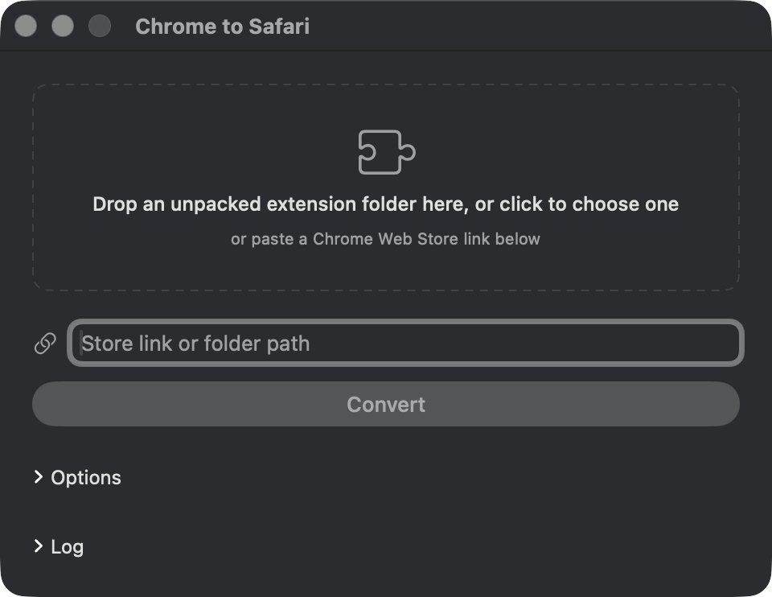

# PortKit

Turn any Chrome extension (or any WebExtension) into a working, signed Safari extension — **no paid Apple Developer ID required**.

Safari can run Chrome extensions, but unsigned ones get **disabled every time Safari restarts**, so you're forever re-ticking "Allow unsigned extensions" in the Develop menu. PortKit signs the extension with a **free** Apple ID, so once you enable it in Safari it stays enabled for good. It also rewrites the manifest and injects a small compatibility shim so the extension doesn't just *install* in Safari — it actually *works*.

## Demo

https://github.com/user-attachments/assets/44111fd5-4475-4d19-8c9f-11b571000dcc

## Two ways to use it

- **App (GUI)** — download the DMG, drag PortKit to Applications, open it. Drop an extension on the window and hit Convert.
- **CLI** — grab `chrome-to-safari.sh` and run it from the terminal.

Both share the same engine; pick whichever you like.

## Before you start: a free signing certificate

One time, about two minutes:

1. Open **Xcode → Settings → Accounts**
2. Click **+** and sign in with your Apple ID — no paid membership needed
3. Select your account → **Manage Certificates…** → **+** → **Apple Development**

You also need **Xcode** installed (the full app, not just Command Line Tools) — the converter and build steps need it.

## App (GUI)

Open **PortKit**, then drop your unpacked extension folder — or a `.crx` / `.zip` — onto the window (or click to pick one), **or** paste a Chrome Web Store link. Pick a mode and go:

- **Install** — convert, build, sign, install to `/Applications`, open Safari. (default)
- **Build only** — convert and build, but don't install.
- **Temp-load** — stage the extension for Safari's "Add Temporary Extension" with **no Xcode build** (fastest iteration; must be re-added after each Safari restart).

The **Analyze** button reports what PortKit will change *before* you commit to a build. The **Options** section is optional — leave every field blank for sensible defaults.



**First launch:** the app is ad-hoc signed (no paid Apple ID), so macOS shows a Gatekeeper prompt the first time. Open **System Settings → Privacy & Security** and click **Open Anyway** (once). On older macOS, right-click the app → **Open**.

## CLI

Point the script at a folder, an archive, or a store link:

```bash
# A local unpacked extension folder
./chrome-to-safari.sh /path/to/extension

# A .crx / .zip / .xpi file (detected by content, not by extension)
./chrome-to-safari.sh /path/to/extension.crx

# A Chrome Web Store link (downloaded and unpacked for you)
./chrome-to-safari.sh "https://chromewebstore.google.com/detail/<name>/<id>"

# A direct .crx / .zip download URL
./chrome-to-safari.sh "https://example.com/my-extension.crx"
```

Flags:

```
--analyze       Report Safari-compat issues and exit (no build)
--json          With --analyze, print machine-readable JSON
--temp-load     Stage for Safari's "Add Temporary Extension" (no Xcode)
--build-only    Convert + build, but don't install to /Applications
--keep-module   Keep background.type:"module" (default strips it)
--ui            Open the PortKit app UI (dev: compiles ui.swift on first run)
```

Each default run converts, builds, signs, installs to `/Applications`, and opens Safari.

### Options (environment variables)

All optional; they match the app's **Options** section.

| Variable    | Default                              | Purpose                          |
|-------------|--------------------------------------|----------------------------------|
| `APP_NAME`  | `"name"` field from `manifest.json`  | Display name of the wrapper app  |
| `BUNDLE_ID` | `com.converted.<slug>`               | Bundle identifier                |
| `TEAM_ID`   | auto-detected from your keychain     | Apple team ID (if you have several certificates) |
| `OUT_DIR`   | `<extension-parent>/<slug>-safari`   | Where the Xcode project and build output go |

```bash
APP_NAME="My Cool Extension" BUNDLE_ID=com.me.coolext ./chrome-to-safari.sh ./my-extension
```

## What it does, step by step

1. **Resolves the input.** A store link is fetched from Google's own update endpoint; a `.crx`/`.zip`/`.xpi` is detected by its magic bytes (so a mislabeled file still works) and unpacked; a folder is used directly.
2. **Stages a Safari-ready copy.** Your source is never modified — everything happens in a throwaway copy.
3. **Fixes the manifest** for Safari (see below).
4. **Injects a compatibility shim** into content scripts and every extension HTML page so unsupported `chrome.*` APIs degrade quietly instead of throwing and blanking the page.
5. **Converts** with Apple's `xcrun safari-web-extension-converter`.
6. **Normalizes bundle identifiers** so the build doesn't fail with *"Embedded binary's bundle identifier is not prefixed with the parent app's bundle identifier"*.
7. **Builds and signs** with `xcodebuild` and your free Apple Development certificate, verifies the signature, installs to `/Applications`, and launches the app + Safari.
8. **Cleans up** the generated Xcode project and build tree once the app is installed. Use `--build-only` to keep them.

Re-running is safe — it re-converts and rebuilds from scratch each time.

### Manifest fixes

Each one repairs a *silent* Safari failure (the extension would install, then quietly not work):

- Strips `background.type: "module"` (a known cause of silent popup failures) — override with `--keep-module`.
- Forces a non-persistent background (Safari rejects a persistent one).
- Drops a `strict_max_version` cap (an `18.*` cap hides the extension on Safari 18+).
- Removes Chrome-only keys (`update_url`, `key`, `minimum_chrome_version`).
- Strips permissions Safari doesn't implement (`tabGroups`, `offscreen`, `sidePanel`, `debugger`).

### Compatibility shim

Injected at runtime so pages don't blank on a missing API:

- `chrome.storage.sync` → routed to `chrome.storage.local` (Safari has no iCloud extension sync; data persists but doesn't sync across devices).
- `sidePanel`, `identity`, `notifications`, `tabGroups`, `offscreen`, `debugger` — stubbed so evaluation survives.

## Building the app yourself

```bash
./scripts/build-app.sh            # → build/PortKit.app and build/PortKit.dmg
./scripts/build-app.sh --app-only # skip the DMG
```

The build compiles `ui.swift`, generates the icon (`scripts/make_icon.swift`), bundles the engine, and signs — with a Developer ID cert if you have one, otherwise ad-hoc.

## Tests

```bash
python3 test/test_manifest_fix.py
python3 test/test_project_formats.py # macOS: CLI coverage for both Xcode project formats
```

## Limitations

- **Signing is per-machine.** A development-signed app only counts as signed on the Mac that built it. You can't distribute the built *extension* to other people — they should run PortKit on their own Mac. Public distribution requires a paid Apple Developer account and notarization.
- **Not every Chrome API exists in Safari.** The shim covers common gaps; anything with no Safari equivalent is stubbed so the extension loads, but the underlying feature won't work. Run `--analyze` to see what's affected.
- **Blocking `webRequest` ad blockers can't block in Safari.** WebKit decides each request before extension JavaScript runs — no shim can change that. Use a `declarativeNetRequest` build (e.g. uBlock Origin Lite) instead.
- **Free certificates expire after about a year.** Re-run to re-sign when that happens.

## Troubleshooting

- **"No Apple Development certificate found"** — do the one-time setup above.
- **Extension doesn't appear in Safari** — quit and reopen Safari, then check Safari → Settings → Extensions. Make sure the wrapper app ran at least once.
- **Multiple certificates / wrong team** — pass `TEAM_ID=XXXXXXXXXX` explicitly. Find yours with `security find-identity -v -p codesigning`.
- **App won't open (Gatekeeper)** — System Settings → Privacy & Security → **Open Anyway**, or right-click → Open on older macOS.

## Privacy & Terms

- [Privacy Policy](PRIVACY.md) — nothing collected, nothing transmitted
- [Terms of Use](TERMS.md) — MIT, as-is, no warranty

## License

MIT — see [LICENSE](LICENSE).
